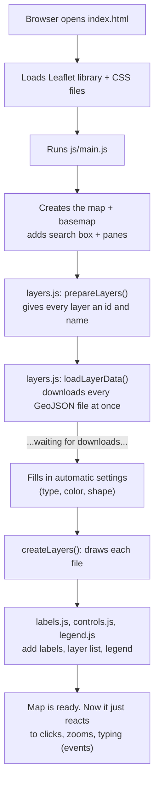

# Learning Guide: Understanding Your Map's Code

This guide is for someone who knows basic C++ (variables, loops, functions, classes, data structures) but hasn't used JavaScript, HTML or CSS before.

**How to use it:** read Part 1 to get the big picture, then open the files in the order in Part 3. Every file has comments written in plain language. When a comment uses a hard word, it's tagged like **[📖 Closure]**: look it up in [GLOSSARY.md](GLOSSARY.md) (Cmd+F the word).

---

## Part 1: The big picture

### The three languages of a web page

A web page is built with three languages, each with one job. Think of building a house:

| Language | Job | In a house | In this project |
|---|---|---|---|
| **HTML** | *what's there* | the walls and rooms | `index.html` (one empty box for the map) |
| **CSS** | *how it looks* | paint, furniture, lighting | `css/styles.css` |
| **JavaScript** | *what it does* | the electricity and plumbing | everything in `js/` |

Your C++ knowledge transfers almost entirely to **JavaScript**. HTML and CSS aren't programming languages at all: they're descriptions, closer to a settings file.

### What happens when you open the map, step by step

*(GitHub draws the diagram above. In VS Code, open the Markdown preview with Cmd+Shift+V.)*

In words:

1. **The browser opens `index.html`.** It's nearly empty: just a `
` box, plus a list of files to load.
2. **It loads Leaflet**, the mapping library, which creates the global `L` (as in `L.map`, `L.marker`, ...).
3. **It runs `js/main.js`.** This is your `int main()`. It imports the other files and calls them in order.
4. **The map, basemap, search box and panes are created** immediately.
5. **The data starts downloading.** Here's the big difference from C++: JavaScript doesn't stop and wait. It hands over a "call me when you're done" function ([📖 Promise], [📖 Callback]) and carries on.
6. **When the downloads finish**, the rest of `main.js` runs: build layers, labels, layer list, legend, and zoom to fit.
7. **From then on, nothing runs until something happens**: a click, a zoom, a keystroke ([📖 Event]). Each one triggers a small function that was registered earlier.

That last point is the biggest mental shift. A C++ console program runs top to bottom and exits. **A web page sets things up and then waits, reacting to events, for as long as it's open.**

### The two halves of the code

| Part | Files | You'll edit it... |
|---|---|---|
| **Settings** | `js/config.js` | for every new map |
| **Engine** | the other `js/` files + `css/styles.css` | rarely: only to change how the template behaves or looks |

---

## Part 2: C++ → JavaScript cheat sheet

| C++ | JavaScript | Notes |
|---|---|---|
| `int x = 5;` | `let x = 5;` | No types. [📖 Dynamic typing] |
| `const int x = 5;` | `const x = 5;` | Use `const` by default. [📖 const and let] |
| `std::string s = "hi";` | `const s = "hi";` or `'hi'` | Both quote styles are the same. |
| `s1 + s2` | `s1 + s2` | Same. |
| `std::vector<int> v = {1,2};` | `const v = [1, 2];` | [📖 Array] |
| `v.push_back(3);` | `v.push(3);` | |
| `v.size()` | `v.length` | No parentheses! |
| `struct P { int x; int y; };` `P p{1,2};` | `const p = { x: 1, y: 2 };` | No struct needed. [📖 Object] |
| `p.x` | `p.x` or `p["x"]` | |
| `std::map<std::string,int> m;` | `const m = {};` | Objects double as maps. |
| `nullptr` | `null` (and `undefined`) | [📖 null and undefined] |
| `==`, `!=` | `===`, `!==` | Always three! [📖 Strict equality] |
| `int f(int a) { return a*2; }` | `function f(a) { return a * 2; }` | |
| `{ return a*2; }` | `a => a * 2` | [📖 Arrow function] |
| `for (auto& x : v)` | `for (const x of v)` or `v.forEach(x => ...)` | [📖 for...of] [📖 Array methods] |
| `for (int i = 0; i < n; i++)` | `for (let i = 0; i < n; i++)` | Same. |
| `if`, `else`, `while`, `switch`, `break`, `continue`, `return` | identical | `switch` also works on strings. |
| `cond ? a : b` | `cond ? a : b` | Same. [📖 Ternary operator] |
| `std::transform`, `copy_if`, `find_if` | `.map`, `.filter`, `.find` | [📖 Array methods] |
| `auto [a, b] = pair;` | `const [a, b] = pair;` | [📖 Destructuring] |
| `#include "x.h"` | `import { thing } from "./x.js";` | [📖 Module] |
| `std::cout << x;` | `console.log(x);` | Shows in the browser console. [📖 Console] |
| `throw std::runtime_error("x");` | `throw new Error("x");` | |
| `try { } catch (e) { }` | same, or `.catch(e => ...)` on a promise | [📖 Promise] |
| `new` / `delete` | `new` / *(automatic)* | [📖 Garbage collection] |
| `class B : public A` | `class B extends A` (Leaflet: `A.extend({...})`) | [📖 Class (JavaScript)] |
| `this->x` | `this.x` | [📖 this] |
| compile errors | *none*: errors appear when the code runs, in the console | |

**Five things that will trip you up at first:**

1. **No compiler catches mistakes.** A typo shows up as a red error in the browser console only when that line runs. Keep the console open ([📖 Console]).
2. **`===` not `==`.** The two-equals version converts types and gives surprising answers.
3. **Missing values don't crash.** Reading a key an object doesn't have gives `undefined`, which can quietly travel through your code. The template uses this on purpose for defaults.
4. **Objects are shared, not copied.** `const b = a;` makes `b` point to the *same* object, like a pointer ([📖 Reference]).
5. **Code after a `.then(...)` runs *before* the code inside it.** Anything that needs downloaded data goes *inside* the `.then` ([📖 Promise]).

---

## Part 3: Reading order

Each file's header box says "read this Nth". Here's the plan, with what you'll learn in each:

| # | File | What it does | New ideas you'll meet |
|---|---|---|---|
| 1 | `index.html` | Page frame | tags, `
`, `<script>`, how files load |
| 2 | `js/config.js` | **Your settings** | objects, arrays, `const`, `export`/`import` |
| 3 | `js/main.js` | The step-by-step story | functions, callbacks, promises, events |
| 4 | `js/layers.js` | Loads and draws data | `fetch`, regular expressions, spread `...`, closures |
| 5 | `js/popups.js` | Popup text | functions that make functions |
| 6 | `js/controls.js` | Layer list, switches | the DOM: finding and changing page elements |
| 7 | `js/legend.js` | Legend | building HTML from strings |
| 8 | `js/labels.js` | Fits area names | plain algorithms, loops, geometry (feels like C++!) |
| 9 | `js/search.js` | Address search | talking to an online service, debouncing |
| 10 | `css/styles.css` | All the looks | selectors, properties, the box model, flexbox |

**Tip:** you don't need to understand everything at once. For making new maps, files 1 and 2 are enough. The rest is there for when you want to change how the template itself works.

---

## Part 4: Hands-on missions

The fastest way to learn is to change something and see what happens. Each mission is a small, safe experiment. Start the map with **Live Server** first so you can see changes when you save.

**If something breaks:** in the VS Code terminal, run `git checkout -- .` to undo every change since your last commit. (git keeps a copy, so you can't lose work you've committed.)

### 🟢 Level 1: Settings (`js/config.js`)

1. **Rename the map.** Change `title: "My Map"` and look at the browser tab. *(Concept: [📖 Object])*
2. **Recolor a layer.** Add `color: "#9b5de5",` to the Example Places entry. Pick your own color with Google's "color picker". *(Concept: [📖 Hex color])*
3. **Change a shape.** Add `shape: "star",` to the same entry, then try `"drop"` and `"book"`.
4. **Start hidden.** Add `visible: false,` and check the layer list. *(Concept: [📖 Truthy and falsy])*
5. **Break it on purpose.** Delete one comma between two settings and save. The map goes blank. Open the console (Cmd+Option+J) and read the red error: it names the file and line. Put the comma back. **This is the most useful skill on this list.** *(Concept: [📖 Console])*

### 🟡 Level 2: Engine tweaks

6. **Labels sooner.** In `js/labels.js`, change `MIN_ZOOM = 13` to `12`. *(Concept: [📖 const and let])*
7. **Peek at the data.** In `js/main.js`, just inside `.then(function ({ data, problems }) {`, add the line `console.log(data);`. Save, open the console, and click the triangles to explore your GeoJSON as JavaScript objects. Remove the line afterwards. *(Concepts: [📖 GeoJSON], [📖 Promise])*
8. **Prove the "waiting" idea.** Add `console.log("A");` *before* `loadLayerData()` in `main.js`, `console.log("B");` as the first line *inside* the `.then(...)`, and `console.log("C");` at the very bottom of the file. What order do they print in? (Answer: A, C, B. C runs while the data is still downloading.) *(Concept: [📖 Promise])*
9. **More automatic colors.** Add your favorite hex colors to `AUTO_COLORS` in `js/layers.js`. *(Concept: [📖 Array])*

### 🟠 Level 3: Looks (`css/styles.css`)

10. **Live CSS editing.** Right-click the legend → Inspect. In the Styles panel on the right, change `padding` or `background` values and watch them update. Nothing is saved, so experiment freely. *(Concept: [📖 DevTools])*
11. **Rounder panels.** Change `--ui-radius: 12px;` to `24px` in section 1. Every panel changes at once. *(Concept: [📖 CSS variable])*
12. **Your own point shape.** Copy the `.point-shape-diamond` rule, rename it `.point-shape-arrow`, and change its polygon to `polygon(50% 0, 100% 50%, 70% 50%, 70% 100%, 30% 100%, 30% 50%, 0 50%)`. Then use `shape: "arrow"` in `config.js`. *(Concept: [📖 clip-path])*

### 🔴 Level 4: Real features

13. **Add your own data.** Download any GeoJSON (search "[your city] open data GeoJSON"), put it in `Data/`, and add `{ file: "YourFile.geojson" },` to `LAYERS`.
14. **Write a custom popup.** Open the file, find the property names inside `"properties": {...}`, and write a popup in `POPUPS` using `field(...)`. Use it with `popup: POPUPS.yourName`.
15. **Score coloring.** If your data has a 0-1 number column, try `type: "scorePolygons"` with `scoreField: "THAT_COLUMN"`.

---

## Part 5: When something goes wrong

| What you see | Most likely cause | Fix |
|---|---|---|
| Blank map, no controls | A syntax error (often a missing comma or bracket in `config.js`) | Open the console (Cmd+Option+J); the red error names the file and line |
| Red box: "file not found in the Data folder" | File name in `config.js` doesn't exactly match (capitals count!) | Copy the exact name from the `Data/` folder |
| Red box: "opened straight from disk" | You double-clicked `index.html` | Use Live Server |
| A layer is in the wrong place (e.g. off Africa) | Coordinates aren't longitude/latitude (WGS84) | Re-export the file as EPSG:4326 |
| A change doesn't show up | The browser cached the old file | Hard refresh: **Cmd+Shift+R** |
| Search box missing | `SEARCH.apiKey` is empty | Add a Geoapify key |

**Debugging habit:** when unsure what a variable holds, `console.log(it)` and look. It's the web version of printing to `std::cout`.

---

## Part 6: Websites to learn from

### JavaScript
- **javascript.info** ("The Modern JavaScript Tutorial"). The best free, in-order course. Since you know C++, you can skim Part 1 quickly. Read "Arrays", "Objects", "Arrow functions", "Closure" and "Promises, async/await" carefully.
- **MDN Web Docs** (developer.mozilla.org). The official reference for JavaScript, HTML and CSS. When you see a built-in like `.filter` or `fetch`, search "MDN filter".
- **Learn X in Y Minutes: JavaScript** (learnxinyminutes.com/docs/javascript). The whole language on one page. Perfect for someone who already programs.
- **Eloquent JavaScript** (eloquentjavascript.net). A free online book; chapters 1-6 and 11 (asynchronous programming) fit this project.
- **regex101.com**. Paste a regular expression and it explains each piece. *(For [📖 Regular expression])*

### HTML and CSS
- **MDN "Learn web development"** (developer.mozilla.org/en-US/docs/Learn). Structured beginner lessons for HTML and CSS.
- **W3Schools** (w3schools.com). Quick lookups with "Try it yourself" editors. Good for "what does this CSS property do?"
- **CSS Diner** (flukeout.github.io). A game that teaches [📖 Selector]s.
- **Flexbox Froggy** (flexboxfroggy.com). A game that teaches [📖 Flexbox].
- **CSS-Tricks: "A Complete Guide to Flexbox"** (css-tricks.com). The classic visual reference.
- **Clippy** (bennettfeely.com/clippy). Draw [📖 clip-path] shapes for new point symbols.
- **Kevin Powell** (YouTube). Friendly, clear CSS videos.

### Leaflet and maps
- **Leaflet tutorials** (leafletjs.com/examples.html). Short official tutorials; "Quick Start" and "Using GeoJSON with Leaflet" match this project exactly.
- **Leaflet API reference** (leafletjs.com/reference.html). Every `L.something` explained.
- **geojson.io**. View, draw and inspect GeoJSON files in the browser.
- **mapshaper.org**. Simplify big map files so they load faster.

### All-in-one courses
- **freeCodeCamp** (freecodecamp.org). Free interactive "Responsive Web Design" and "JavaScript" courses.
- **The Odin Project** (theodinproject.com). A free full path from zero to building websites.

### Git and GitHub
- **GitHub Skills** (skills.github.com). Short interactive courses inside GitHub itself.
- **Oh My Git!** (ohmygit.org). A game that teaches git visually.

---

## Part 7: Words to know first

If you only look up ten glossary entries, make it these. They unlock most of the code:

1. [📖 Object]: `{ key: value }` bundles, used everywhere
2. [📖 Array methods]: `.map`, `.filter`, `.forEach`
3. [📖 Arrow function]: `x => x * 2`
4. [📖 Truthy and falsy]: why `a || b` gives a default
5. [📖 Callback]: "call this function later"
6. [📖 Promise]: waiting for downloads
7. [📖 Closure]: functions that remember
8. [📖 DOM]: JavaScript changing the page
9. [📖 GeoJSON]: the shape of your data
10. [📖 Selector]: how CSS picks what to style

Happy mapping! 🗺️
